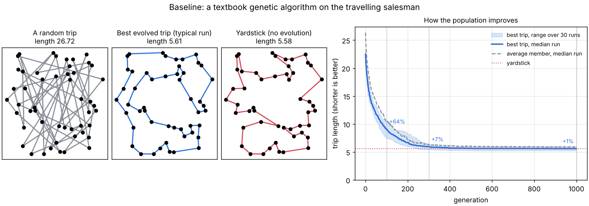
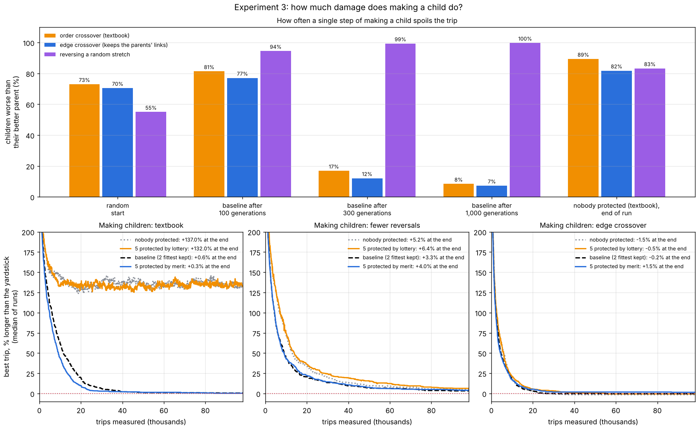
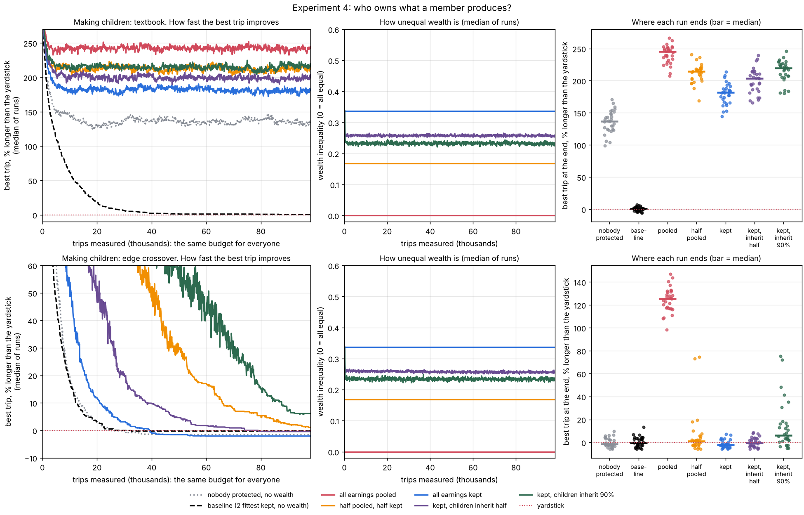
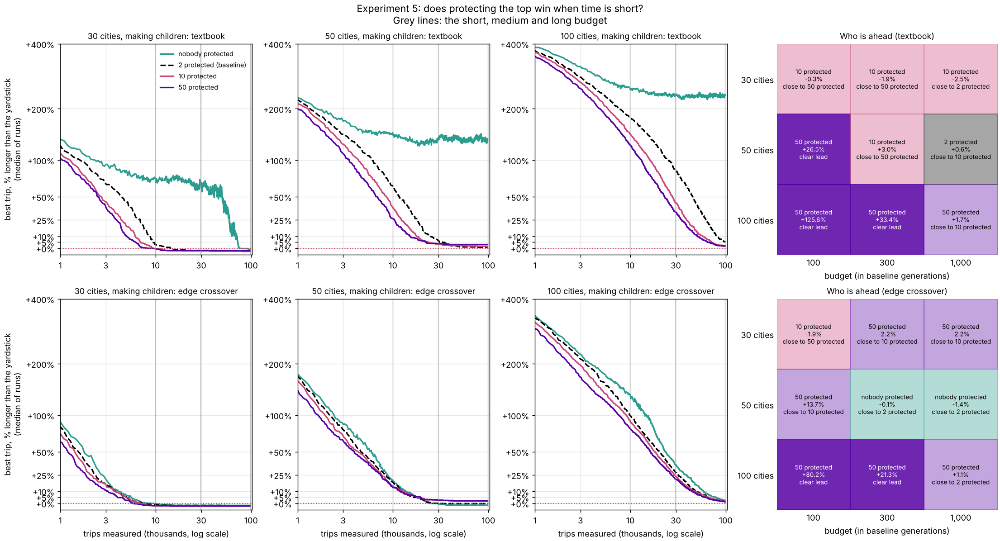
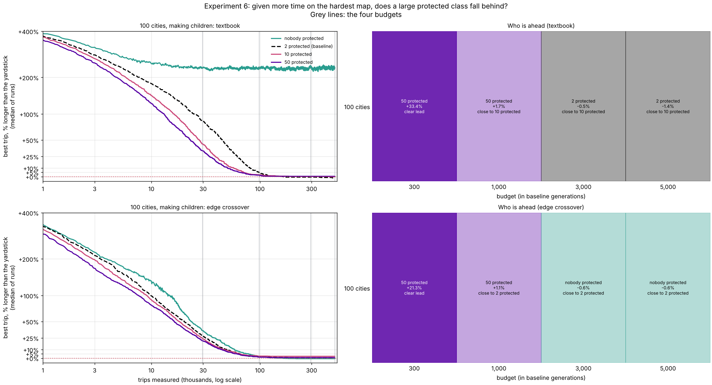

# evosoc

A genetic algorithm experiment comparing social structures. Does a population evolve better when power and resources are concentrated (a few decide for everyone, output is pooled) or when they are spread out (each member decides and keeps what it earns)? When does which work better, and why?

Every society solves the same problem under the same budget. Only the social rules change.

**What the experiments so far do and do not test.** Experiments 1, 2, 3, 5 and 6 study a *protected class*: a few members who are guaranteed to survive each generation unchanged. They decide nothing for anyone else. Parents are still chosen by the same contest as always, and the protected shape the population only by staying alive to be chosen again. So these experiments measure **privilege, or protecting the top**, not central control. A society in which a few really do decide for everyone is a separate experiment, still to come. Experiment 4 turns the other dial: who owns what members produce.

## The problem: the travelling salesman

50 cities are scattered on a map. A solution is a round trip that visits every city once. Shorter is better. Anyone can check a solution at a glance, and the problem is hard enough that a population has to improve step by step.

## Step 1: the neutral baseline

Before comparing societies, we need a reference point that has no social structure at all: a standard, textbook genetic algorithm.

- **Population:** 100 round trips, each starting as a random order of cities.
- **Each generation:**
  1. The 2 shortest trips are kept unchanged.
  2. Every other place goes to a child. Each parent is chosen by a small contest: pick 3 members at random, the shortest trip wins.
  3. The child takes a stretch of one parent's trip and fills in the remaining cities in the order the other parent visits them (order crossover).
  4. Sometimes (30% of children), a random stretch of the child's trip is reversed (mutation).
- **Budget:** 1,000 generations, about 98,000 trips measured per run. That is long enough for runs to settle, so the result shows where a population gets stuck, not only how fast it starts.

Nobody inside the population decides anything, and nothing is owned: the rules are fixed before the run, and a member is rewarded only for the length of its current trip.



**How to read it.** Left to right: a random trip, the best trip the population evolved in a typical run, and a yardstick found without evolution (a greedy trip, then repeatedly untangled where it crosses itself). On the right, the solid line is the best trip in each generation for the typical run; the shaded band shows the best and worst of 30 independent runs. The dashed line is the average member. The percentages mark how much longer the typical best trip is than the yardstick after 100, 300 and 1,000 generations.

**What it shows.** Evolution turns a tangle into a sensible route. It is far off early (+64% at generation 100), close by generation 300 (+7%) and level with the yardstick at the end (+1%). Single runs end anywhere from 6% shorter to 7% longer than the yardstick: luck matters, which is why every comparison uses 30 seeds. Societies will be compared at all three points, since one may start fast and stall while another starts slow and keeps going.

## Experiment 1: a protected class that always survives

The first step away from the baseline changes one rule only: **who is protected**. The *k* fittest members (the shortest trips) are guaranteed to survive into the next generation, unchanged. That is all they gain: they make no decisions for anyone. Everyone else is replaced by children, exactly as in the baseline. The baseline itself is the case of 2 protected members.

- **Compared:** 1, 2 (baseline), 5, 20 and 50 protected members in a population of 100.
- **Fair budget:** every society may measure the same number of trips (98,100). Protected members are not measured again, so a society that protects more makes fewer children per generation and gets more generations (50 protected: 1,960 generations of 50 children).
- **Same map, same 30 seeds** as the baseline.
- **Variety:** how different the average member's route is from the best member's route (the share of its city-to-city links that the best trip does not use). 0 means everyone copies the leader.


**How to read it.** Left: how far the best trip is from the yardstick as the budget is used up (median of 30 runs). Middle: how varied the population stays. Right: where each of the 30 runs ends; the bar is the median.

| Protected | After 9,900 trips | After 29,500 trips | At the end (98,100) |
|---|---|---|---|
| 1 | +81% | +13% | +0.9% |
| 2 (baseline) | +64% | +7% | +0.6% |
| 5 | +44% | +3% | +0.3% |
| 20 | +36% | +3% | +1.1% |
| 50 | +27% | +4% | +3.0% |

*Median gap to the yardstick; the full numbers, including the spread, are in `results/rulers.json`.*

**What it shows.**

- **A larger protected class gets results faster.** Keeping the best members safe means good routes are never lost and get copied again and again. With 50 protected the population is more than twice as close to the yardstick early on as the baseline.
- **It also makes everyone alike sooner.** The more members are protected, the faster variety collapses (middle chart). Once everyone travels nearly the same route, there is little left to recombine.
- **In the long run, protecting too many hurts.** With 50 protected, runs stop improving around 30,000 trips and end clearly worse than the baseline (+3.0% vs +0.6%; a shuffling test says a gap this large would arise by chance about 2% of the time). Between 1 and 20 protected the end results differ by less than the luck between runs.
- **So the answer depends on the time available.** A big protected class is the better choice when the budget is short, and the worse one when there is time for the population to get stuck. Experiment 5 tests this directly by varying the budget and the difficulty of the map.

## Experiment 2: does it matter who is protected?

Experiment 1 protected the fittest members. Is the benefit due to *having* a protected class at all, or to protecting the fittest? Here the size of the protected class stays fixed (5 or 20) and only the way it is chosen changes:

- **By merit:** each generation, the fittest members are protected and kept unchanged (as in Experiment 1).
- **By lottery:** each generation, the protected members are drawn at random and kept unchanged, however long their trips are. This is protection without merit.
- **By birth:** each protected seat passes to one of the holder's own children every generation, however long that child's trip is. The first holders are the fittest of the random starting population; after that, only birth counts. The protected still have to compete like everyone else to become parents of other children.

Two references run alongside: the baseline (the 2 fittest are kept) and a society where **nobody is protected**, and every member is replaced by a child each generation. As before, every society gets the same budget of about 98,100 measured trips and 30 runs.


**How to read it.** One row per size of protected class. Left: how far the best trip is from the yardstick as the budget is used up. Middle: how varied the population stays. Right: where each of the 30 runs ends. Note that the left charts go up to 200%: lines that stay near the top never get anywhere.

| Society | After 9,900 trips | After 29,500 trips | At the end (98,100) |
|---|---|---|---|
| Nobody protected | +149% | +134% | +137% |
| Baseline (2 fittest) | +64% | +7% | +0.6% |
| 5 by merit | +44% | +3% | +0.3% |
| 5 by lottery | +133% | +133% | +132% |
| 5 by birth | +150% | +140% | +144% |
| 20 by merit | +36% | +3% | +1.1% |
| 20 by lottery | +137% | +132% | +135% |
| 20 by birth | +167% | +167% | +166% |

*Median gap to the yardstick; the full numbers, including the spread and the shuffling tests, are in `results/choosing.json`.*

**What it shows.**

- **Protection alone does nothing. Merit is what matters.** Members protected by lottery do no better than when nobody is protected. Every one of the 30 lottery runs ends far behind every merit run.
- **Without the fittest being kept, this population cannot improve.** When nobody is protected, or the protected are not the fittest, the best trip stalls more than twice as long as the yardstick within the first few thousand trips. Making a child here usually breaks part of a good route, so a good route that is not protected is lost again before it can spread. Keeping even the 2 best members is enough to fix this.
- **Inherited privilege is the worst of all, and gets worse the larger the protected class.** Heirs take their seats however long their trips are, so the seats are wasted on poor routes, and those poor routes are passed down again. With 20 hereditary seats, runs end at +166%, worse than protecting nobody.
- **Variety tells the same story.** Societies that cannot hold on to good routes stay very varied (middle chart): their members never agree on anything, because nothing good lasts long enough to be copied.

**A caution.** This result depends on how much damage making a child does. In this problem, children are usually worse than their parents, so a society that does not protect its best members falls apart. A gentler way of making children could narrow the gap between merit and the rest. Experiment 3 tests this directly, and it does: with a gentler way of making children, the gap disappears.

## Experiment 3: how much damage does making a child do?

Experiment 2 found that only societies that keep their fittest members ever get anywhere. That could be a fact about protection, or just a side effect of how children are made in the textbook method. This experiment separates the two.

**Part 1: measure the damage.** A child is made in up to two steps: two parents are combined (crossover), then sometimes a random stretch of the child's trip is reversed. For each step on its own, we take populations from baseline runs at different stages, make 300 children per population, and count how often the child's trip is longer than its better parent's. Two ways of combining parents are measured:

- **Order crossover** (the textbook method used so far): the child copies one stretch of one parent's trip and visits the remaining cities in the order the other parent does. Most of the links between cities are rebuilt, so good stretches are often torn apart.
- **Edge crossover:** a trip is really a set of links between pairs of cities. The child is built almost entirely from links that one of its parents already uses, and only creates a new link when it is stuck.

**Part 2: does the damage decide who wins?** Four societies from the earlier experiments (nobody protected, 5 protected by lottery, the baseline, 5 protected by merit) run again under three ways of making children, with the same budget, map and 30 seeds:

- **Textbook:** order crossover, and 30% of children get a random reversal (as before).
- **Fewer reversals:** order crossover, but only 5% of children get a random reversal.
- **Edge crossover:** edge crossover, and 30% of children get a random reversal.



**How to read it.** Top: the share of children worse than their better parent, for each single step, at different stages of a baseline run, and in a society where nobody is protected, once it has stopped improving. Bottom: one chart per way of making children; each line is one society, showing how far its best trip is from the yardstick as the budget is used up (median of 30 runs).

| Society | Textbook | Fewer reversals | Edge crossover |
|---|---|---|---|
| Nobody protected | +137% | +5.2% | −1.5% |
| 5 by lottery | +132% | +6.4% | −0.5% |
| Baseline (2 fittest) | +0.6% | +3.3% | −0.2% |
| 5 by merit | +0.3% | +4.0% | +1.5% |

*Median gap to the yardstick at the end (98,100 trips). Negative means shorter than the yardstick. The full numbers, including earlier checkpoints, the spread and the shuffling tests, are in `results/reproduction.json`.*

**What it shows.**

- **A random reversal almost always spoils a good trip.** Once a population has found decent routes (after 300 generations), 99% of reversals make the trip longer, by about 15%. Crossover, by contrast, rarely does harm late in a run, because by then the parents are nearly identical.
- **Early on, every step does damage.** In a young population, 55–95% of children are worse than their better parent, whichever step made them. This is the phase in which a society without protected members gets stuck: its best trips are replaced by worse children faster than selection can spread them.
- **The advantage of protecting the fittest comes from the way children are made, not from protection itself.** With the textbook method, a society that does not protect its fittest never improves (+137%). With fewer reversals or with edge crossover, the same unprotected society does as well as one that protects the fittest. Under edge crossover, nobody protected ends at −1.5% and 5 protected by merit at +1.5%; the gap is within the luck between runs (a shuffling test gives about 18%). Under edge crossover, protection by lottery is no longer a disadvantage either; with fewer reversals it still trails merit slightly (+6.4% vs +4.0%).
- **Gentle is not always better.** Fewer reversals rescues the unprotected society but slows everyone down: the population runs out of new ideas, and all four societies end 3–6% above the yardstick. Edge crossover keeps the reversals and makes every society improve fastest early on (+17–22% after 9,900 trips, against +44–149% with the textbook method).

**What this means for the comparison.** Keeping the best members safe is a remedy for a process of change that destroys more than it builds. When change is gentle and builds on what already works, a population that protects nobody does just as well. Later experiments will therefore report results under both the textbook and the edge-crossover way of making children, so that a conclusion about protection is not really a conclusion about how children are made.

## Experiment 4: who owns what a member produces?

Experiments 1–3 varied **who is protected**. This one turns a different dial: **who owns the output**. Members now earn something, and what they own decides how many children they can have.

- **Earning.** Each generation, every member earns from its trip, by rank: the shortest trip earns 2, the longest earns nothing, the average member earns 1.
- **Wealth buys children.** Every child's mother is drawn at random in proportion to wealth: a member with twice the wealth expects twice the children. Partners are still chosen by a small contest, as in the baseline; ownership only decides who can afford children, not whom they choose.
- **Pooling.** A share of all earnings goes into a common pool that is split evenly between all members. Fully pooled, everyone has the same wealth and expects the same number of children, however good its trip.
- **Inheritance.** When a member is replaced, a share of its wealth passes to its children, split evenly between them; the rest is used up. With 90% inherited, about nine tenths of a member's wealth comes from its ancestors' trips rather than its own.

Nobody is protected in any of these societies. Two references from the earlier experiments run alongside: **nobody protected** (mothers chosen by a small contest, nothing owned) and the **baseline** (the 2 fittest kept). Every society runs under both ways of making children from Experiment 3: the textbook method and edge crossover. Same budget (about 98,100 measured trips), same map, same 30 seeds.



**How to read it.** One row per way of making children. Left: how far the best trip is from the yardstick as the budget is used up (median of 30 runs). Middle: how unequal wealth is (0 means everyone owns the same). Right: where each of the 30 runs ends.

| Society | Textbook, at the end | Edge crossover: after 9,900 trips | after 29,500 | at the end (98,100) | Wealth inequality |
|---|---|---|---|---|---|
| Nobody protected, no wealth | +137% | +20% | −0.1% | −1.4% | – |
| Baseline (2 fittest kept) | +0.6% | +18% | −0.1% | −0.2% | – |
| All earnings pooled | +245% | +129% | +125% | +125% | 0 |
| Half pooled, half kept | +214% | +92% | +74% | +1.1% | 0.17 |
| All earnings kept | +181% | +54% | +3.1% | −2.1% | 0.34 |
| Kept, children inherit half | +204% | +71% | +21% | −0.4% | 0.26 |
| Kept, children inherit 90% | +220% | +93% | +78% | +6.1% | 0.23 |

*Median gap to the yardstick. Wealth inequality is the Gini index (0 = all equal, 1 = one member owns everything), averaged over the second half of each run. The full numbers, including the spread and the shuffling tests, are in `results/ownership.json`.*

**What it shows.**

- **With the textbook way of making children, every society with wealth fails.** Wealth spreads children more evenly than the contest does, so good routes spread more slowly, and the damage done by making children wins (see Experiment 3). This row says little about ownership; the edge-crossover row is the real test.
- **Fully pooled output never gets anywhere.** When everyone gets the same number of children whatever it produces, the only push towards better routes is the choice of partners. That is not enough: every one of its 30 runs ends further from the yardstick than every run of the other societies, about twice as long as the yardstick.
- **Keeping what you earn works as well as the contest, but starts slower.** With all earnings kept, the population ends level with the unprotected reference (−2.1% vs −1.4%; a shuffling test gives about 47%, so the gap is luck). It needs more trips to get there, because earning by rank rewards the best members less sharply than winning a contest.
- **Pooling half of the output slows progress down a lot but does not stop it.** Half pooled is far behind for most of the budget (+74% after 29,500 trips) and only catches up near the end; two of its 30 runs never do.
- **Inheritance slows progress too, and the more is inherited, the worse.** Inherited wealth reflects the ancestors' trips, not the member's own, so children go to the descendants of past winners rather than to today's best. With half inherited, the society still ends level with the others, but much later. With 90% inherited, it ends clearly behind (+6.1% vs −1.4%; a shuffling test says a gap this large would arise by chance about 0.02% of the time), and several runs stay stuck 30–75% above the yardstick.
- **Inheritance does not make wealth more unequal here; it makes it less unequal.** A rich member has many children, and its estate is split between all of them, so large fortunes are quickly divided. The problem with inheritance in this model is not inequality. It is that wealth stops telling the population who is good at the task right now.

**What this means for the comparison.** In this population, owning one's output is what makes progress possible at all: the more of it is pooled, the slower the population improves, and full pooling stops it. But ownership that is passed down blurs the link between reward and current performance, and with enough of it, a society of owners falls behind a society with no wealth at all. The results so far suggest the two dials do not line up with "left" and "right" in a simple way: what matters in both is whether the members who are good at the task *now* get more say over the next generation. Protecting the fittest (Experiment 1) and kept earnings both do that; protection by lottery or by birth, pooled output and large inheritances all weaken it.

**Limits of this model.** Wealth here only buys children: it does not earn a return, so a fortune cannot grow on its own, and estates are always split evenly between children. Both are choices of this experiment; returns on wealth and a single heir would likely make inherited wealth more unequal and longer-lived.

## Experiment 5: does protecting the top win when time is short?

Experiment 1 hinted that a large protected class is the better choice when the budget is short and the worse one when there is time to get stuck. Here this is tested directly, by varying how hard the problem is and how much time the population gets.

- **Societies:** nobody protected, or the 2 (the baseline), 10 or 50 fittest protected, in a population of 100. As in Experiment 1, the protected are guaranteed to survive and decide nothing for others.
- **Difficulty:** maps of 30, 50 and 100 cities. More cities means many more possible trips.
- **Time:** a short, a medium and a long budget: as many trips as the baseline measures in 100, 300 and 1,000 generations (9,900, 29,500 and 98,100 trips). A run does not know its budget, so reading a long run at an earlier point gives exactly what a shorter run would.
- **Two ways of making children:** the textbook way and edge crossover (see Experiment 3), so that a conclusion about protection is not really a conclusion about how children are made.
- **Same 30 seeds** for every combination. A lead counts as *clear* when a shuffling test says a gap this large between the leader and the runner-up would arise by chance less than 5% of the time.



**How to read it.** One row per way of making children. The first three charts show, for each map, how far the best trip is from the yardstick as the budget is used up (median of 30 runs; both axes are on a log scale so that early and late progress are both visible). The grey lines mark the short, medium and long budget. The grid on the right shows which society is ahead at each budget on each map: dark means a clear lead, pale means the runner-up is within the luck between runs.

| Map | Making children | Short budget | Medium budget | Long budget |
|---|---|---|---|---|
| 30 cities | textbook | 10 protected (−0.3%), close | 10 protected (−1.9%), close | 10 protected (−2.5%), close |
| 30 cities | edge crossover | 10 protected (−1.9%), close | 50 protected (−2.2%), close | 50 protected (−2.2%), close |
| 50 cities | textbook | **50 protected (+27%), clear** | 10 protected (+3.0%), close | 2 protected (+0.6%), close |
| 50 cities | edge crossover | 50 protected (+14%), close | nobody protected (−0.1%), close | nobody protected (−1.4%), close |
| 100 cities | textbook | **50 protected (+126%), clear** | **50 protected (+33%), clear** | 50 protected (+1.7%), close |
| 100 cities | edge crossover | **50 protected (+80%), clear** | **50 protected (+21%), clear** | 50 protected (+1.1%), close |

*The society ahead, its median gap to the yardstick, and whether its lead is clear. The full numbers for every society, including the spread, are in `results/pressure.json`.*

**What it shows.**

- **What matters is time relative to difficulty.** A large protected class wins clearly in every case where the population is still far from a good trip: the short budget on 50 cities, and the short and medium budget on 100 cities. There, 50 protected are well ahead of 10, and every society that protects more than the baseline is far ahead of the baseline (on 100 cities after 29,500 trips: +33% against +85% under the textbook way).
- **Once there is enough time, the advantage disappears.** On the easy map, or with the long budget, all societies that protect anyone end within a few percent of the yardstick and within the luck between runs of one another. No society wins clearly.
- **The cost of protecting many shows only where the problem is solved early.** On 50 cities, the large protected class stops improving once it has converged, and the others catch up and pass it. With edge crossover the society that protects nobody ends ahead (−1.4% against +2.0% for 50 protected); a shuffling test puts this at the edge of luck (about 7%). With the textbook way, 50 protected end clearly behind the baseline (+3.0% vs +0.6%, about 3%), as in Experiment 1.
- **The textbook way still punishes societies that protect nobody.** Without protection and with textbook children, the population only escapes its early stall on the smallest map, and only late in the run. With edge crossover, protecting nobody is never far behind.

**What this means.** Protecting the top buys speed: keeping the best members safe lets a good idea spread before it is lost. That speed matters most when the problem is large and the time is short. When there is ample time, the advantage is gone, and a hint of its cost appears: a population that copies its best members too early has fewer ideas left to combine. On these maps, the cost is small and the benefit, when it exists, is large. Experiment 6 gives the hardest map more time, to see whether the cost grows once the large protected class gets stuck there too.

## Experiment 6: given more time on the hardest map, does a large protected class fall behind?

In Experiment 5, 50 protected were still ahead on the 100-city map at the longest budget, because no society had finished improving yet. On 50 cities, the large protected class lost its lead once it got stuck. Does the same happen on the hard map, given enough time?

- **Same societies and rules as Experiment 5:** nobody protected, or the 2 (the baseline), 10 or 50 fittest protected, on the 100-city map, under both ways of making children, with the same 30 seeds.
- **Longer budgets:** as many trips as the baseline measures in 300, 1,000, 3,000 and 5,000 generations (up to 490,100 trips, five times the longest budget so far).



**How to read it.** As in Experiment 5: on the left, the best trip as the budget is used up (median of 30 runs, log scales); on the right, which society is ahead at each budget.

| Making children | Society | 300 gens | 1,000 gens | 3,000 gens | 5,000 gens |
|---|---|---|---|---|---|
| textbook | nobody protected | +232% | +233% | +234% | +236% |
| textbook | 2 protected (baseline) | +85% | +4.8% | −0.5% | **−1.4%** |
| textbook | 10 protected | +44% | +2.2% | +0.3% | −0.1% |
| textbook | 50 protected | **+33%** | +1.7% | +0.4% | +0.4% |
| edge crossover | nobody protected | +36% | +2.1% | **−0.6%** | **−0.6%** |
| edge crossover | 2 protected (baseline) | +28% | +1.4% | +0.6% | +0.6% |
| edge crossover | 10 protected | +24% | +2.3% | +2.1% | +2.1% |
| edge crossover | 50 protected | **+21%** | +1.1% | +0.7% | +0.7% |

*Median gap to the yardstick; the society ahead at each budget is in bold. The full numbers, including the spread, are in `results/endurance.json`.*

**What it shows.**

- **The lead changes hands, as on 50 cities.** 50 protected are clearly ahead at 300 generations and still (not clearly) ahead at 1,000. By 3,000 they have been overtaken under both ways of making children.
- **The large protected class stops first.** Under the textbook way, only 1 of the 30 runs with 50 protected improved at all between 3,000 and 5,000 generations, against 7 of 30 with 10 protected and 13 of 30 with the baseline. The baseline keeps creeping downwards and ends ahead of 50 protected (−1.4% against +0.4%; a gap this large would arise by chance about 3% of the time).
- **With edge crossover, everyone gets stuck by 3,000 generations,** and the society that protects nobody ends ahead (−0.6%). Its lead over the baseline and over 50 protected is within luck. 10 protected end clearly behind nobody protected (+2.1%, chance below 0.1%) and the baseline (about 3%). Why 10 protected do worse here than 50 is not explained by this experiment; it may be specific to this map.
- **The cost stays small.** At the end, all societies that protect anyone, and the one that protects nobody under edge crossover, are within about 2% of one another. Early on the differences are tens of percent.

**What this means.** The pattern from 50 cities holds on the hard map once it has time to play out: protecting the top wins the sprint and loses the marathon. But the marathon is close. The losses from protecting many come late and are a few percent; the gains come early and are large. A society that protects few or none only comes out ahead when there is plenty of time, and only by a little. Whether that small edge grows when the problem keeps changing, so that a society has to keep finding new ideas, is a question for a later experiment.

## Run it yourself

```
pip install -e ".[test]"
python -m evosoc baseline          # writes results/baseline.{png,json,csv}
python -m evosoc rulers            # writes results/rulers.{png,json,csv}
python -m evosoc choosing          # writes results/choosing.{png,json,csv}
python -m evosoc reproduction      # writes results/reproduction.{png,json,csv}
python -m evosoc ownership         # writes results/ownership.{png,json,csv}
python -m evosoc pressure          # writes results/pressure.{png,json,csv}
python -m evosoc pressure --cities 100 --budgets 300 1000 3000 5000 --name endurance \
  --title $'Experiment 6: given more time on the hardest map, does a large protected class fall behind?\nGrey lines: the four budgets'
                                   # writes results/endurance.{png,json,csv}; about 2 hours
pytest
```

Every run is seeded: the same options give exactly the same numbers. `--map-seed` picks the map, `--seeds` sets how many independent runs; see `python -m evosoc <experiment> --help`. The command `rulers` and the option `--rulers` are older names for the protected class; `--protected` works too.
