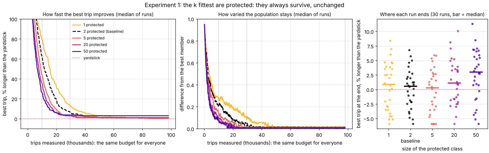
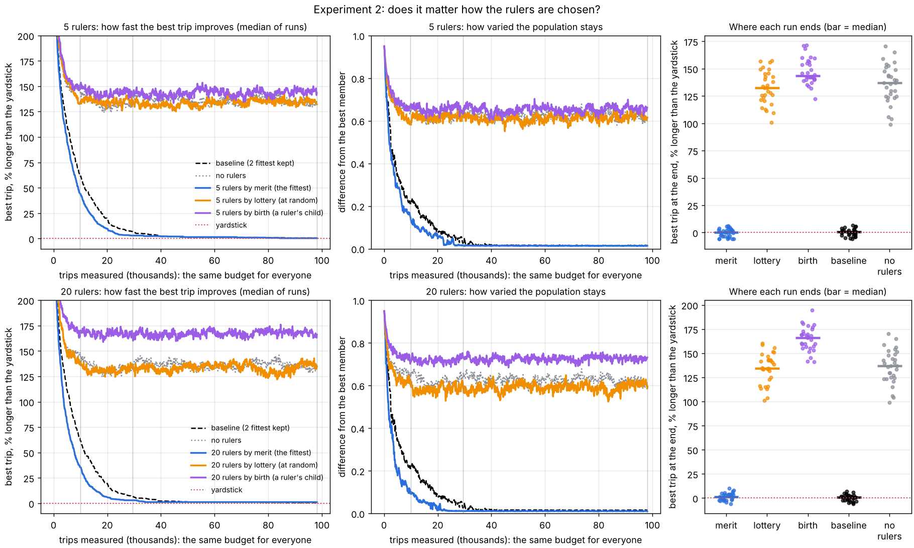

# evosoc

A genetic algorithm experiment comparing social structures. Does a population evolve better when power and resources are concentrated (rulers decide, output is pooled) or when they are spread out (each member decides and keeps what it earns)? When does which work better, and why?

Every society solves the same problem under the same budget. Only the social rules change.

## The problem: the travelling salesman

50 cities are scattered on a map. A solution is a round trip that visits every city once. Shorter is better. Anyone can check a solution at a glance, and the problem is hard enough that a population has to improve step by step.

## Step 1: the neutral baseline

Before comparing societies, we need a reference point that has no social structure at all: a standard, textbook genetic algorithm.

- **Population:** 100 round trips, each starting as a random order of cities.
- **Each generation:**
  1. The 2 shortest trips are kept unchanged.
  2. Every other place goes to a child. Each parent is chosen by a small contest: pick 3 members at random, the shortest trip wins.
  3. The child takes a stretch of one parent's trip and fills in the remaining cities in the order the other parent visits them (order crossover).
  4. Sometimes (30% of children), a random stretch of the child's trip is reversed (mutation).
- **Budget:** 1,000 generations, about 98,000 trips measured per run. That is long enough for runs to settle, so the result shows where a population gets stuck, not only how fast it starts.

Nobody inside the population decides anything, and nothing is owned: the rules are fixed before the run, and a member is rewarded only for the length of its current trip.


**How to read it.** Left to right: a random trip, the best trip the population evolved in a typical run, and a yardstick found without evolution (a greedy trip, then repeatedly untangled where it crosses itself). On the right, the solid line is the best trip in each generation for the typical run; the shaded band shows the best and worst of 30 independent runs. The dashed line is the average member. The percentages mark how much longer the typical best trip is than the yardstick after 100, 300 and 1,000 generations.

**What it shows.** Evolution turns a tangle into a sensible route. It is far off early (+64% at generation 100), close by generation 300 (+7%) and level with the yardstick at the end (+1%). Single runs end anywhere from 6% shorter to 7% longer than the yardstick: luck matters, which is why every comparison uses 30 seeds. Societies will be compared at all three points, since one may start fast and stall while another starts slow and keeps going.

## Experiment 1: a ruling class that always survives

The first step away from the baseline turns one dial only: **who decides**. A ruling class of the *k* fittest members is guaranteed to survive into the next generation, unchanged. Rulers are chosen by merit (the shortest trips), and what they gain is survival. Everyone else is replaced by children, exactly as in the baseline. The baseline itself is the case of 2 rulers.

- **Compared:** 1, 2 (baseline), 5, 20 and 50 rulers in a population of 100.
- **Fair budget:** every society may measure the same number of trips (98,100). Rulers are not measured again, so a society with more rulers makes fewer children per generation and gets more generations (50 rulers: 1,960 generations of 50 children).
- **Same map, same 30 seeds** as the baseline.
- **Variety:** how different the average member's route is from the best member's route (the share of its city-to-city links that the best trip does not use). 0 means everyone copies the leader.



**How to read it.** Left: how far the best trip is from the yardstick as the budget is used up (median of 30 runs). Middle: how varied the population stays. Right: where each of the 30 runs ends; the bar is the median.

| Rulers | After 9,900 trips | After 29,500 trips | At the end (98,100) |
|---|---|---|---|
| 1 | +81% | +13% | +0.9% |
| 2 (baseline) | +64% | +7% | +0.6% |
| 5 | +44% | +3% | +0.3% |
| 20 | +36% | +3% | +1.1% |
| 50 | +27% | +4% | +3.0% |

*Median gap to the yardstick; the full numbers, including the spread, are in `results/rulers.json`.*

**What it shows.**

- **A larger ruling class gets results faster.** Keeping the best members safe means good routes are never lost and get copied again and again. With 50 rulers the population is more than twice as close to the yardstick early on as the baseline.
- **It also makes everyone alike sooner.** The more rulers, the faster variety collapses (middle chart). Once everyone travels nearly the same route, there is little left to recombine.
- **In the long run, too many rulers hurts.** With 50 rulers, runs stop improving around 30,000 trips and end clearly worse than the baseline (+3.0% vs +0.6%; a shuffling test says a gap this large would arise by chance about 2% of the time). Between 1 and 20 rulers the end results differ by less than the luck between runs.
- **So the answer depends on the time available.** A big ruling class is the better choice when the budget is short, and the worse one when there is time for the population to get stuck. This is tested directly in a later experiment that varies the budget and the difficulty of the map.

## Experiment 2: does it matter how the rulers are chosen?

Experiment 1 chose the rulers by merit: the fittest members. Is the benefit due to *having* a protected ruling class at all, or to choosing it by merit? Here the size of the ruling class stays fixed (5 or 20) and only the way it is chosen changes:

- **By merit:** each generation, the fittest members rule and are kept unchanged (as in Experiment 1).
- **By lottery:** each generation, the rulers are drawn at random and kept unchanged, however long their trips are. This is protection without merit.
- **By birth:** each ruler's seat passes to one of its own children every generation, however long that child's trip is. The first rulers are the fittest of the random starting population; after that, only birth counts. Rulers still have to compete like everyone else to become parents of other children.

Two references run alongside: the baseline (the 2 fittest are kept) and a society with **no rulers** at all, where every member is replaced by a child each generation. As before, every society gets the same budget of about 98,100 measured trips and 30 runs.



**How to read it.** One row per size of ruling class. Left: how far the best trip is from the yardstick as the budget is used up. Middle: how varied the population stays. Right: where each of the 30 runs ends. Note that the left charts go up to 200%: lines that stay near the top never get anywhere.

| Society | After 9,900 trips | After 29,500 trips | At the end (98,100) |
|---|---|---|---|
| No rulers | +149% | +134% | +137% |
| Baseline (2 fittest) | +64% | +7% | +0.6% |
| 5 by merit | +44% | +3% | +0.3% |
| 5 by lottery | +133% | +133% | +132% |
| 5 by birth | +150% | +140% | +144% |
| 20 by merit | +36% | +3% | +1.1% |
| 20 by lottery | +137% | +132% | +135% |
| 20 by birth | +167% | +167% | +166% |

*Median gap to the yardstick; the full numbers, including the spread and the shuffling tests, are in `results/choosing.json`.*

**What it shows.**

- **Protection alone does nothing. Merit is what matters.** Rulers drawn by lottery do no better than no rulers at all. Every one of the 30 lottery runs ends far behind every merit run.
- **Without the fittest being kept, this population cannot improve.** With no rulers, or with rulers who are not the fittest, the best trip stalls more than twice as long as the yardstick within the first few thousand trips. Making a child here usually breaks part of a good route, so a good route that is not protected is lost again before it can spread. Keeping even the 2 best members is enough to fix this.
- **Inherited rule is the worst of all, and gets worse the larger the ruling class.** Heirs take their seats however long their trips are, so the seats are wasted on poor routes, and those poor routes are passed down again. With 20 hereditary rulers, runs end at +166%, worse than having no rulers.
- **Variety tells the same story.** Societies that cannot hold on to good routes stay very varied (middle chart): their members never agree on anything, because nothing good lasts long enough to be copied.

**A caution.** This result depends on how much damage making a child does. In this problem, children are usually worse than their parents, so a society that does not protect its best members falls apart. A gentler way of making children could narrow the gap between merit and the rest. This is worth testing directly before drawing wider conclusions.

## Run it yourself

```
pip install -e ".[test]"
python -m evosoc baseline          # writes results/baseline.{png,json,csv}
python -m evosoc rulers            # writes results/rulers.{png,json,csv}
python -m evosoc choosing          # writes results/choosing.{png,json,csv}
pytest
```

Every run is seeded: the same options give exactly the same numbers. `--map-seed` picks the map, `--seeds` sets how many independent runs; see `python -m evosoc <experiment> --help`.
