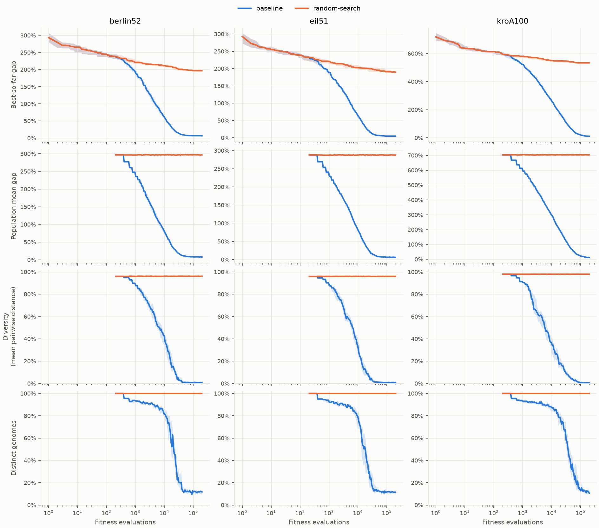
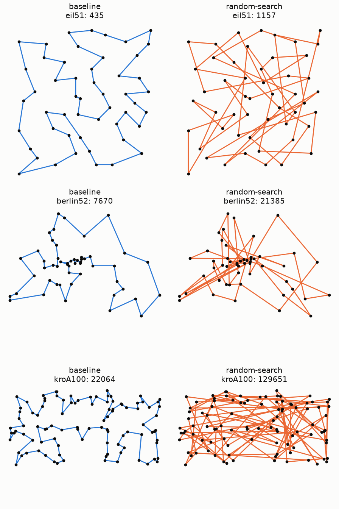

# The baseline GA: design notes

> Status: **decided and implemented** as `steady_state_ga`
> (`src/evosoc/algorithms/steady_state.py`).

## The brief

The baseline is the fixed reference every new GA is compared against. It
must be:

* **standard**: a plain genetic algorithm as found in any textbook, with no
  problem-specific tricks, special cases or over-engineering. A classroom
  example.
* **robust and known to work** on TSP, so that it is a credible reference
  and not a straw man.
* **as close to nature as the standard options allow.** Wherever the
  textbook offers a choice (how to select parents, how to recombine, who
  dies), pick the option closest to biological evolution. Guiding test:
  *could this happen in a natural population without anyone knowing the
  whole population?* If the most natural option does not work, take the
  most natural one that does, and write down why.

Out of scope because it is engineering, not a GA: local search on offspring
(2-opt, memetic algorithms), heuristic start tours (nearest neighbour),
restarts, adaptive parameters, and the TSP-specialised operators that are
really optimisers in disguise (e.g. EAX).

## The algorithm

```
population   N = 200 random tours, fixed size, anyone can mate with anyone
repeat, one birth at a time:
  parents    two different individuals, each the fitter of two that meet at random
  crossover  with p = 0.9 order crossover (OX); otherwise a copy of the first parent
  mutation   with p = 0.2 reverse a random stretch of the tour (inversion)
  death      the newborn joins; of two individuals that meet at random, the less fit dies
```

That is the whole algorithm: about 50 lines in `steady_state.py`. Metrics are
reported every N births (a "generation equivalent").

## Component by component

### Representation
A tour is a permutation of the cities (path representation). The standard
choice; nothing else is needed.

### Parent selection: binary tournament

| Option | Close to nature? | Verdict |
|---|---|---|
| Truncation (only the top *k* % breed) | No: a hard cut-off that needs a ranking of everyone. Animal breeding, not nature. | |
| Linear ranking | No: needs a ranking of everyone | |
| Fitness-proportionate (roulette wheel) | Partly: expected offspring ∝ fitness, like fecundity. But needs an arbitrary transform of tour length into "fitness" (1/length, scaling), which nature does not have, and it is fragile when all tours are similarly long. | |
| **Tournament of 2** | **Yes**: two individuals meet and the fitter one gets to mate. Local, no global knowledge, like competition for mates. | **Chosen.** Standard, robust, needs no fitness transform. |

The two parents are different individuals: nothing mates with itself.

### Survival: steady state, the less fit of two dies

| Option | Close to nature? | Verdict |
|---|---|---|
| Generational: all parents die, *N* children replace them | Only for annual plants and mayflies | Tested and **rejected**: with binary tournaments it does not work on TSP (see below) |
| Generational + elitism (the best survive unchanged) | No: an immortal champion | |
| **Steady state**: one birth, one death at a time | **Yes**: overlapping generations, as in most animals | **Chosen** |

Who dies: the less fit of two individuals that meet at random (the mirror
image of parent selection). This is ordinary viability selection. As a side
effect the current best individual can never die (it is never the less fit of
two), so no explicit elitism is needed.

Why not the classroom generational GA? It was measured (10 seeds, 200k
evaluations): with binary tournaments, selection is too weak to outweigh
the disruption of crossover, and the population never converges. It only
works with larger tournaments (5) or with elitism, i.e. with more tuning
or a less natural rule. Steady state works with the mildest, most natural
setting.

| median final gap to optimum | eil51 | berlin52 | kroA100 |
|---|---|---|---|
| generational, tournament of 2 | 122 % | 105 % | 381 % |
| generational, tournament of 2, elitism 1 | 61 % | 49 % | 228 % |
| **steady state (chosen)** | **5.8 %** | **4.8 %** | **10.8 %** |

### Crossover: order crossover (OX)

| Option | Close to nature? | Verdict |
|---|---|---|
| PMX | No clear analogue; inherits positions, which do not matter for a round trip | |
| **OX** (Davis 1985) | **Yes**: the tour analogue of crossing-over. The child keeps one contiguous stretch from one parent, and the rest comes from the other parent in that parent's order. | **Chosen.** The standard classroom crossover for TSP. |
| Edge recombination (ERX) | No: builds the child by a greedy step-by-step walk that looks ahead to avoid dead ends, a construction heuristic | Used by an earlier version of this baseline. Dropped: more complex, not natural, and no better at the end (below) |
| Edge assembly (EAX) | No: effectively a local optimiser | Out of scope |

Crossover rate 0.9, the textbook value: most births are sexual; the rest are
copies of one parent.

Earlier ERX vs OX in the same GA (10 seeds): final gap 6.7 / 8.0 / 10.3 % (ERX)
vs 5.8 / 4.8 / 10.8 % (OX) on eil51 / berlin52 / kroA100. ERX gets there
faster, but it does not end better, and it is the one piece of the old
baseline that was not a classroom component.

### Mutation: inversion

| Option | Close to nature? | Verdict |
|---|---|---|
| Swap two cities | Point-like change, but breaks 4 connections at once | |
| **Inversion** (reverse a stretch of the tour) | **Yes**: a real mutation, the chromosomal inversion | **Chosen.** Changes exactly 2 connections. The standard, best-performing simple TSP mutation. |
| Insertion / displacement | Transposition ("jumping genes") | Plausible, less common |

Applied to a newborn with probability 0.2; the stretch is chosen uniformly
(2 to *n* − 2 cities: reversing fewer or more leaves the tour unchanged).

### Parameters
Textbook values, untuned: N = 200, crossover 0.9, mutation 0.2. A variant
should get the same (zero) tuning effort.

## What the baseline does (measured)

`configs/baseline.toml`: 200k evaluations, 20 seeds.

| median final gap to optimum | eil51 | berlin52 | kroA100 |
|---|---|---|---|
| **baseline** | **4.8 %** | **6.7 %** | **10.8 %** |
| random search | 190 % | 197 % | 533 % |



* It works: within 5–11 % of the optimum, far better than random search.
* **It converges prematurely, as a plain GA does.** Diversity falls below
  5 % after about 25k evaluations (45k on kroA100), and about 90 % of the
  population ends as copies of a few tours. From then on the GA mostly
  polishes one family of solutions. This is the well-known weakness of a
  single well-mixed population, not a bug, and it is exactly what the
  diversity panels are there to show.



## Parameter check

`configs/baseline-check.toml`: one change at a time from the default, 10 seeds.

| change | berlin52 final gap | kroA100 final gap |
|---|---|---|
| default (N = 200, mutation 0.2) | 4.8 % | **10.8 %** |
| mutation on every birth | 15.5 % | 90.9 % |
| N = 1000 | **3.7 %** | 57.5 % |

The textbook defaults are the best or close to it. They stay.

## Guarantees (enforced by tests)

`tests/test_baseline.py` checks, on every change:

* **Reproducible:** same seed, same run, bit for bit.
* **Pinned:** a reference run (berlin52, seed 0, 20k evaluations) must
  reproduce its recorded result exactly. If a later change (a refactor, or
  shared code touched while building a variant) alters the baseline's
  behaviour even slightly, this test fails. Update the pinned value only on
  purpose.
* **Invariants:** the population size is constant, every genome is a valid
  tour, the best individual never dies, and the budget is used exactly.
* **Input validation:** invalid parameters and tiny instances are rejected
  with a clear error instead of running silently wrong.
