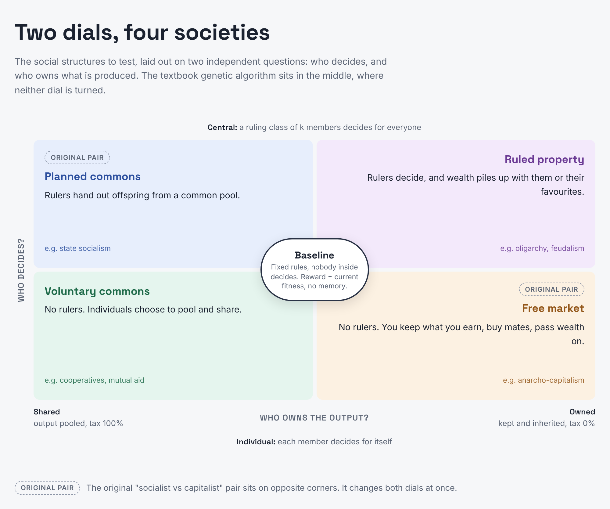

# Design draft: two dials, four societies

> Draft. Nothing here is final.

## The two dials

Every social structure we test is placed on two independent questions:

| Dial | One end | Other end |
|---|---|---|
| **Who decides?** | Central: a ruling class of *k* members decides for everyone (k = 1 is an autocrat) | Individual: each member decides for itself (k = everyone) |
| **Who owns the output?** | Shared: everything is pooled (tax 100%) | Owned: kept and inherited (tax 0%) |

The **baseline** is a textbook genetic algorithm. It sits in the middle: nobody inside the population decides anything (the rules are fixed before the run), and nothing is owned (reward is current fitness, with no memory).

## The four corners

| | Shared | Owned |
|---|---|---|
| **Central** | **Planned commons.** Rulers hand out offspring from a common pool. *(e.g. state socialism)* | **Ruled property.** Rulers decide, and wealth piles up with them or their favourites. *(e.g. oligarchy, feudalism)* |
| **Individual** | **Voluntary commons.** No rulers. Individuals choose to pool and share. *(e.g. cooperatives, mutual aid)* | **Free market.** No rulers. You keep what you earn, buy mates, pass wealth on. *(e.g. anarcho-capitalism)* |

## Why a grid instead of a line

- **The usual "socialist vs capitalist" line is one diagonal.** Planned commons and free market differ on both dials at once. If one beats the other, a line cannot say whether that came from having no rulers or from owning your output.
- **The other two corners are the controls.** If ruled property also wins, ownership is what matters. If voluntary commons also wins, the absence of rulers is what matters.
- **It protects against bias.** A result has to show up in two corners before it counts, so no single run can be read as proof for one story.

The first experiment compares the baseline and the four corners, with both dials at their extremes. Later experiments sweep the dials, e.g. rulers k = 1, 5, 20, everyone × tax 0%, 50%, 100%.

## The levers behind each side

Every row is a decision made when building a GA. The outer columns push it to each extreme. (The earlier one-dimensional version is in [one-dimensional-table.md](one-dimensional-table.md).) Rows marked † are existing techniques from the GA literature, so neither side is a caricature.

| # | Lever | Collective, planned | Baseline (textbook GA) | Individual, owned |
|---|---|---|---|---|
| 1 | Who reproduces | Equal or planned share of offspring for everyone | Tournament: fitter of a few random picks | Bought with accumulated wealth, no limit |
| 2 | What you're rewarded for | The group's output, shared out | Own current quality, no memory | Own quality, kept as property |
| 3 | Inheritance | None; everything returns to the pool | Nothing to inherit | Children inherit parents' wealth |
| 4 | Who mates with whom | Centre assigns pairs, e.g. for diversity | Random pairing among the selected | Mate choice: pick or bid for partners † |
| 5 | Mutation rate | One rate, adjusted by the centre (1/5 success rule †) | Fixed rate | Each carries its own evolving rate (self-adaptation †) |
| 6 | Variation method | Centre picks what works for all (adaptive operator selection †) | One fixed crossover and mutation | Each owns its own method |
| 7 | How new solutions are made | Centre designs the next generation from the best (EDA †) | Parents cross over and mutate | As baseline; mating is a private deal |
| 8 | Survival | Fixed, guaranteed lifespan | Whole generation replaced, except a few best | Survive while you can pay upkeep |
| 9 | Elitism | None, or the best is public property | 1–2 best copied unchanged | The wealthy persist without limit |
| 10 | Knowledge sharing | Best solution published to all | Genes spread only through mating | Genes are property; copying costs |
| 11 | Extra improvement effort | Same effort for everyone | One evaluation per child | The wealthy buy extra effort |
| 12 | Group structure | One organised collective | One mixed population | Voluntary groups form and dissolve |
| 13 | Who sets rules and parameters | Ruling class of k members | The designer, fixed before the run | Nobody; behaviour emerges |

Held fixed across all variants: the problem, population size, total number of evaluations, and the code behind each operator.

## Levels of experiments

1. **Level 1: existing dials.** Lean the baseline's own settings one way or the other (rows 1, 5, 9).
2. **Level 2: new mechanics.** Ownership, inheritance and who decides (rows 2, 3, 8, 13).
3. **Level 3: emerging institutions.** Voluntary groups, elected rulers, contracts (rows 10, 12).

## Open questions

- Which problem the population solves (travelling salesman is the current favourite).
- What "wealth" is: the proposal is a claim on future offspring slots.
- How rulers are chosen, and what they gain.
